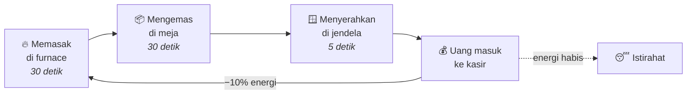

<div align="center">


<br/>


<br/><br/>

**Pet modern yang ringan, imut, dan penuh fitur — dibuat khusus untuk Leftycraft Network.**

<sub>Dikembangkan dengan ❤️ oleh <b>DarkIgnite</b></sub>

<br/>

[✨ Fitur](#-fitur) •
[📦 Instalasi](#-instalasi) •
[⌨️ Perintah](#️-perintah) •
[🔐 Permission](#-permission) •
[⚙️ Konfigurasi](#️-konfigurasi) •
[⚡ Performa](#-performa) •
[🛠️ Build](#️-build-dari-source)

</div>

<br/>

## 🌟 Sekilas

<table>
<tr>
<td width="50%" valign="top">

### 🐾 Pet Display Entity
Kepala melayang yang di-scale rapi dengan `ItemDisplay` + `TextDisplay`. Tanpa AI mob, tanpa physics tick — gerakan halus lewat interpolasi client.

</td>
<td width="50%" valign="top">

### ⚔️ Kelas & Combat
Empat kelas spesialisasi, auto-attack pintar ke mob hostile, dan duel antar pemain lengkap dengan taruhan.

</td>
</tr>
<tr>
<td width="50%" valign="top">

### 🏛️ Training Altar
Struktur 3×3 dengan animasi konstruksi. Upgrade level pet secara AFK dengan potongan waktu hingga **−50%**.

</td>
<td width="50%" valign="top">

### 🍳 Dapur MBG
Kitchen tycoon: pet memasak, mengemas, dan mengantar pesanan untuk menghasilkan uang secara pasif.

</td>
</tr>
</table>

---

## ✨ Fitur

<details open>
<summary><b>🐾 Pet berbasis Display Entity</b></summary>

<br/>

- Pet dirender dengan `ItemDisplay` + `TextDisplay`, **bukan mob** — tidak membebani AI/physics tick server.
- Gerakan dan rotasi diinterpolasi di sisi client sehingga terasa halus.
- **📱 Crossplay Bedrock (GeyserMC):** pemain Bedrock melihat fallback `ArmorStand` tak terlihat yang membawa kepala pet.
- **👻 Anti ghost entity:** semua entity pet *non-persistent* — otomatis hilang saat logout, pindah world, atau restart.

</details>

<details open>
<summary><b>🎭 Kelas pet</b></summary>

<br/>

| | Kelas | Spesialisasi |
| :---: | :--- | :--- |
| 🗡️ | **Fighter** | +50% attack damage · −30% attack cooldown |
| 💖 | **Support** | Aura regenerasi saat HP pemilik di bawah 50% |
| 🌾 | **Looter** | Auto-pickup item di sekitar · +25% mob EXP |
| 🪶 | **Traveler** | Aura Speed II untuk pemilik · +40% kecepatan gerak pet |

Ganti kelas kapan saja dengan `/pet class <kelas>`.

</details>

<details open>
<summary><b>⚔️ Combat & Duel</b></summary>

<br/>

- 🎯 Pet otomatis menembak mob hostile di sekitar pemilik — toggle dengan `/pet attack`.
- 🛡️ Targeting aman: tidak menyerang pemain, villager, maupun pet lain.
- 🥊 **Duel pet** antar pemain, opsional dengan taruhan uang via Vault.

</details>

<details open>
<summary><b>🍖 Energi & makanan</b></summary>

<br/>

- Energi pet (0–100) berkurang saat menyerang dan bekerja di dapur.
- Isi ulang dengan makanan — semua nilainya bisa diatur di config:

| Makanan | Energi | | Makanan | Energi |
| :--- | :---: | :---: | :--- | :---: |
| 🍎 Golden Apple | +100 | | 🍖 Cooked Beef | +30 |
| ✨ Enchanted Golden Apple | +100 | | 🥓 Cooked Porkchop | +30 |
| 🥕 Golden Carrot | +45 | | 🍞 Bread | +15 |
| 🍏 Apple | +10 | | 🫐 Sweet Berries | +8 |

> [!TIP]
> Pet **tidak pernah mati permanen** — hanya pingsan saat energi habis, lalu bangun lagi setelah diberi makan.

</details>

<details open>
<summary><b>🏛️ Training Altar (AFK upgrade)</b></summary>

<br/>

Struktur multi-block **3×3** tempat pet di-upgrade levelnya secara AFK. Altar dibangun dengan animasi blok per blok dan dilengkapi hologram yang otomatis menghadap pemain terdekat.

| Level | Potongan waktu | Progres |
| :---: | :---: | :--- |
| 1 | — | `░░░░░░░░░░` |
| 2 | −10% | `██░░░░░░░░` |
| 3 | −20% | `████░░░░░░` |
| 4 | −30% | `██████░░░░` |
| 5 | −40% | `████████░░` |
| 6 🌌 *Celestial* | **−50%** | `██████████` |

- ⏱️ Durasi upgrade berjalan saat pemain online, dengan cooldown per tier untuk mencegah eksploitasi.
- 🔒 Dilindungi dari griefing — tidak bisa dibongkar saat aktif atau cooldown.
- 🎁 Klaim lewat `/pet altar` (maks. **3× per hari**).
- ⚡ **Instant Upgrader** — item soulbound dari admin untuk menyelesaikan upgrade seketika.

> [!NOTE]
> Altar Level 6 membutuhkan permission `leftypet.celestial`.

</details>

<details open>
<summary><b>🍳 Dapur MBG (Kitchen Tycoon)</b></summary>

<br/>

Tempatkan pet di dapur dan biarkan ia bekerja menghasilkan uang secara pasif:



- 💵 Setiap pesanan menghasilkan uang acak; batas maksimalnya **naik sesuai level pet**.
- 📢 Pengumuman global saat pemain mengklaim kasir (dengan cooldown).
- 🚀 Mendukung multiplier dari plugin **DungeonEventBoost** bila terpasang.

</details>

<details open>
<summary><b>🎨 Lainnya</b></summary>

<br/>

- 🖥️ **Dashboard GUI** untuk semua fitur pet (`/pet`).
- 🗺️ **Roadmap** progresi level beserta milestone bonusnya.
- 🏆 **Leaderboard** top 10 level pet di server.
- 👑 **Skin & trail kosmetik**, termasuk skin eksklusif Member++ dan Celestial.
- 🧱 Integrasi proteksi region dengan **WorldGuard** dan **RedProtect**.

</details>

---

## 📦 Instalasi

**Kebutuhan**

| Komponen | Versi |
| :--- | :--- |
| Server | Paper **1.21+** (atau fork: Purpur, Leaf, dll.) |
| Java | **21** |
| Opsional | Vault + plugin ekonomi, WorldGuard, RedProtect, MythicMobs |

**Langkah**

1. Taruh `LeftyPet-2.0.0.jar` di folder `plugins/`.
2. Restart server.
3. Sesuaikan `plugins/LeftyPet/config.yml`, lalu jalankan `/leftypet reload`.

> [!WARNING]
> Jangan gunakan `/reload` atau PlugMan untuk memuat ulang plugin — selalu restart server.

---

## ⌨️ Perintah

### 🎮 Pemain
<sub>Alias: <code>/lp</code>, <code>/pets</code></sub>

| Perintah | Deskripsi |
| :--- | :--- |
| `/pet` | Buka dashboard GUI pet |
| `/pet summon` | Panggil pet |
| `/pet dismiss` | Simpan pet |
| `/pet rename <nama>` | Ganti nama pet (maks. 15 karakter) |
| `/pet class <kelas>` | Pilih kelas: `FIGHTER` · `SUPPORT` · `LOOTER` · `TRAVELER` |
| `/pet attack` | Aktifkan/nonaktifkan auto-attack |
| `/pet altar` | Klaim Training Altar (maks. 3× per hari) |
| `/pet kitchen` | Buka menu Dapur MBG (alias: `dapur`) |
| `/pet roadmap` | Lihat roadmap progresi level |
| `/pet top` | Lihat top 10 level pet |
| `/pet duel <pemain> [taruhan]` | Tantang pemain lain berduel |
| `/pet duel accept` \| `decline` | Terima/tolak tantangan duel |
| `/pet help` | Tampilkan daftar perintah |

### 🛠️ Admin
<sub>Alias: <code>/lpa</code>, <code>/petadmin</code></sub>

<details>
<summary>Tampilkan perintah admin</summary>

<br/>

| Perintah | Deskripsi |
| :--- | :--- |
| `/leftypet reload` | Muat ulang konfigurasi |
| `/leftypet setlevel <pemain> <level>` | Atur level pet |
| `/leftypet setenergy <pemain> <jumlah>` | Atur energi pet |
| `/leftypet givealtar <pemain> [level]` | Beri item altar (level 1–6) |
| `/leftypet removealtar <pemain>` | Hapus altar milik pemain |
| `/leftypet tpaltar <pemain>` | Teleport ke altar milik pemain |
| `/leftypet givekitchen <pemain>` | Beri item Dapur MBG |
| `/leftypet removekitchen <pemain>` | Hapus dapur milik pemain |
| `/leftypet tpkitchen <pemain>` | Teleport ke dapur milik pemain |
| `/leftypet giveinstantupgrader <pemain> [jumlah]` | Beri Instant Upgrader (soulbound) |
| `/leftypet cleankitchen` | Bersihkan semua ghost entity dapur |

</details>

---

## 🔐 Permission

| Permission | Default | Deskripsi |
| :--- | :---: | :--- |
| `leftypet.use` | ✅ Semua | Akses fitur pet |
| `leftypet.admin` | 🛡️ OP | Akses perintah admin |
| `leftypet.memberplusplus` | ❌ | Buka skin eksklusif Member++ (alias: `leftypet.memberpp`) |
| `leftypet.celestial` | ❌ | Izinkan upgrade altar ke Level 6 |

---

## ⚙️ Konfigurasi

| Bagian | Isi |
| :--- | :--- |
| `settings` | Skala pet, durasi interpolasi, level maksimum |
| `upgrade-durations` | Durasi upgrade per level (detik); di atas level 10 bertambah 30 menit per level |
| `energy` | Energi maksimum, konsumsi per serangan, nilai tiap makanan |
| `economy` | Biaya upgrade via Vault |
| `kitchen` | Rentang penghasilan dapur, bonus per level, cooldown pengumuman |
| `classes` | Nama, ikon, deskripsi, dan multiplier tiap kelas |
| `skins` / `trails` | Daftar skin kepala (Base64) dan efek trail |
| `messages` | Semua pesan plugin (format MiniMessage) |

<details>
<summary>📄 Contoh potongan <code>config.yml</code></summary>

```yaml
settings:
  pet-scale: 1.35              # 1.0 = ukuran kepala normal
  interpolation-duration: 3    # tick
  max-level: 100

# Biaya upgrade = base-cost + (level × cost-per-level)
economy:
  enabled: true
  base-cost: 1000.0
  cost-per-level: 500.0

# Penghasilan per pesanan = acak(base-min, base-max + (level − 1) × bonus-per-level)
kitchen:
  base-min-earnings: 0
  base-max-earnings: 1000
  bonus-per-level: 50
  broadcast-cooldown-minutes: 10
```

</details>

---

## ⚡ Performa

LeftyPet dirancang agar tetap ringan di server ramai:

| | Optimasi | Penjelasan |
| :---: | :--- | :--- |
| 🧱 | **Menghindari sync chunk load** | Ticker memeriksa `World#isChunkLoaded` lebih dulu; pet tidak di-respawn ke chunk yang belum ter-load |
| 🚦 | **Respawn throttling** | Respawn pet dibatasi agar tidak memicu badai event spawn |
| 💤 | **Proximity culling** | Altar masuk mode tidur bila tidak ada pemain dalam radius 32 blok |
| 📝 | **Dirty-checking** | Teks hologram & metadata hanya dikirim ulang saat nilainya berubah |
| 💾 | **Penyimpanan async** | Data dapur disimpan di luar main thread |

---

## 🛠️ Build dari Source

```bash
git clone https://github.com/DarkIgnite/LeftyPet.git
cd LeftyPet
mvn clean package
```

📁 Hasil build: `target/LeftyPet-2.0.0.jar`

<details>
<summary>🗂️ Struktur proyek</summary>

```
src/main/java/com/leftycraft/leftypet/
├── command/    # /pet dan /leftypet
├── config/     # Pemuat config.yml
├── entity/     # ActivePet — entity & perilaku pet
├── gui/        # Menu inventory
├── hook/       # Integrasi WorldGuard & RedProtect
├── listener/   # Event listener
├── manager/    # Logika pet, altar, dapur, duel, leaderboard, ekonomi
├── model/      # Model data
└── util/       # Utilitas: warna, head, schematic, Bedrock
```

</details>

---

<div align="center">

**Dibuat untuk komunitas 🎮 Leftycraft Network**

<sub>© Leftycraft Network · Dikembangkan oleh <b>DarkIgnite</b></sub>


</div>
